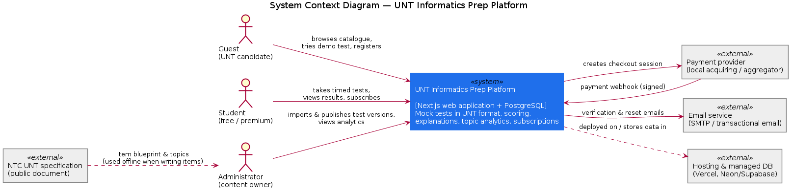
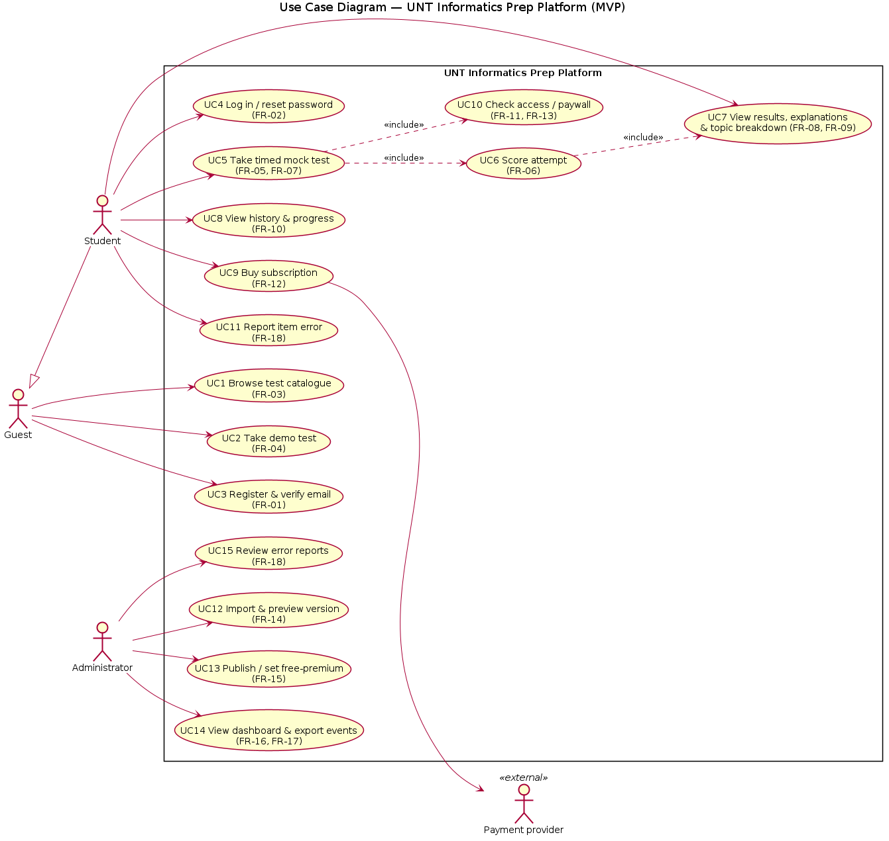
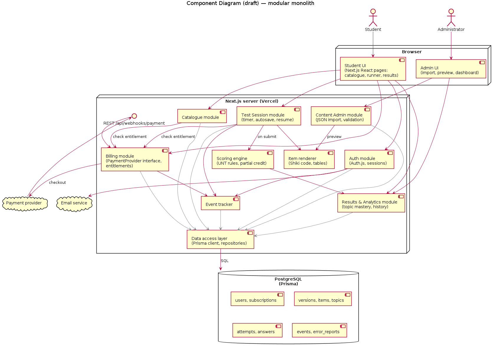
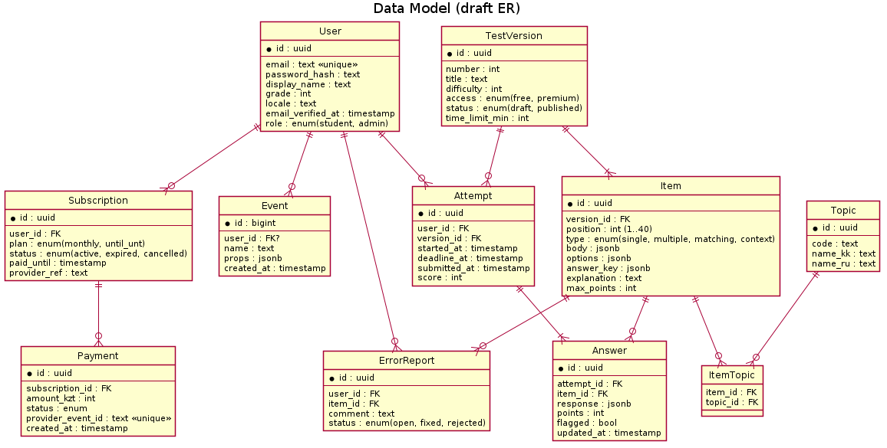

# 7. Architecture and Diagrams

Editable sources of all diagrams are in `diagrams/src/*.puml` (PlantUML) and rendered images are in `diagrams/png/`. To regenerate them:

```bash
java -jar plantuml.jar -tpng -o ../png diagrams/src/*.puml
```

## 7.1 Architectural overview

The platform is a **modular monolith** built with Next.js (TypeScript), using a PostgreSQL database through the Prisma ORM. It is deployed on Vercel with a managed PostgreSQL instance (Neon or Supabase). The decisions behind this choice are in Section 5.

Key architectural principles:

1. **Server-side authority:** entitlement checks, scoring and answer keys live only on the server. The client receives items without keys (NFR-04).
2. **Clear module boundaries** inside one deployable unit: Auth, Catalogue, Test Session, Scoring, Results & Analytics, Billing, Content Admin and Event tracker. Each module accesses the database through a shared data-access layer.
3. **Replaceable external providers:** payments sit behind a `PaymentProvider` interface and email behind a `Mailer` interface.
4. **Resumable test sessions:** an `Attempt` row stores `deadline_at`, and each answer is upserted immediately. The timer is computed from the server deadline, so a reload or network loss does not reset it (FR-05, NFR-02).

## 7.2 System context diagram



*Source: `diagrams/src/01-system-context.puml`*

The platform interacts with three human actors (guest, student, administrator) and with three external systems: the payment provider (checkout and signed webhook), the email service (verification and password reset) and the hosting/database provider. The NTC specification is used offline by the administrator when writing items.

## 7.3 Use case diagram



*Source: `diagrams/src/02-use-case.puml`*

Every use case carries the IDs of the functional requirements it covers (Section 6), so each *Must* requirement can be traced to at least one use case.

## 7.4 Component diagram (draft)



*Source: `diagrams/src/03-component.puml`*

| Component | Responsibility | Requirements |
|---|---|---|
| Student UI / Admin UI | React pages and forms; runner timer display; no answer keys | FR-03…FR-10, FR-14…FR-17 |
| Auth module | Registration, verification, login and sessions, roles | FR-01, FR-02, NFR-03 |
| Catalogue module | Lists published versions and access labels | FR-03, FR-11 |
| Test Session module | Starts an attempt, autosaves answers, resumes, auto-submits | FR-05, NFR-02 |
| Item renderer | Renders code (Shiki), tables, images in the same way for student and admin | FR-07 |
| Scoring engine | Pure functions implementing UNT scoring per item type | FR-06 |
| Results & Analytics | Explanations, topic mastery, history, admin dashboard | FR-08…FR-10, FR-17 |
| Billing module | Checkout, webhook verification, entitlements, expiry | FR-11…FR-13 |
| Content Admin module | JSON import, schema validation, preview, publish | FR-14, FR-15, FR-18 |
| Event tracker | Records product events for funnels | FR-16 |
| Data access layer | Prisma client and repositories; transactions | all |

## 7.5 Data model (draft)



*Source: `diagrams/src/04-data-model.puml`*

`Item.body`, `Item.options` and `Item.answer_key` are JSONB so that the four UNT item types and content blocks (code, table, image) fit one table. A JSON Schema validates them on import.

## 7.6 Key scenario: taking a test (sequence, textual)

1. The student opens a version, and the **Catalogue** asks **Billing** whether the user is entitled to it. If not, the paywall is shown (FR-11).
2. **Test Session** creates an `Attempt` with `deadline_at = now + time_limit` and returns the items *without* answer keys (NFR-04).
3. Every answer change is upserted into `Answer` (FR-05). On reload, the session is restored from the database.
4. On submit or at the deadline, the **Scoring engine** computes points per item, and the `Attempt.score` is stored (FR-06).
5. **Results & Analytics** returns explanations and topic mastery (FR-08, FR-09). The **Event tracker** logs `test_finished`.

## 7.7 Alignment check

| Requirement group | Use cases | Components | Data |
|---|---|---|---|
| Account (FR-01, FR-02) | UC3, UC4 | Auth | User |
| Testing (FR-05…FR-07) | UC5, UC6 | Test Session, Scoring, Renderer | Attempt, Answer, Item |
| Feedback (FR-08…FR-10) | UC7, UC8 | Results & Analytics | Answer, ItemTopic, Topic |
| Monetization (FR-11…FR-13) | UC9, UC10 | Billing | Subscription, Payment |
| Content (FR-14, FR-15, FR-18) | UC11–UC13, UC15 | Content Admin | TestVersion, Item, ErrorReport |
| Analytics (FR-16, FR-17) | UC14 | Event tracker, Results & Analytics | Event |
