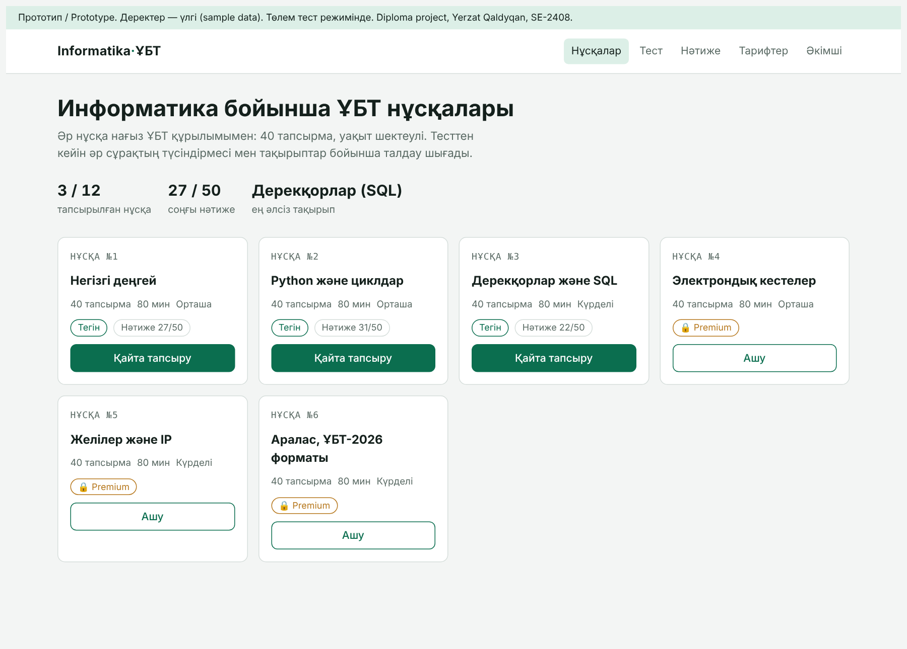
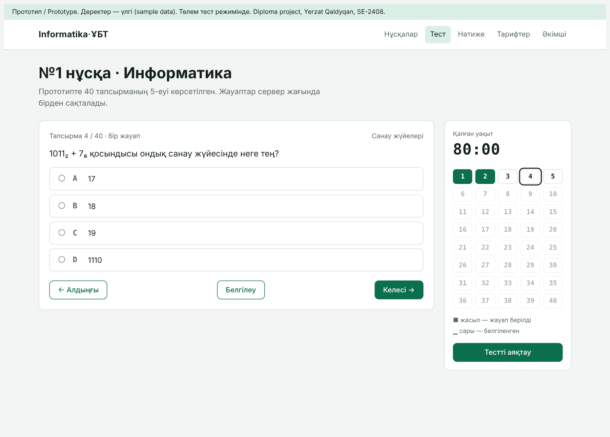
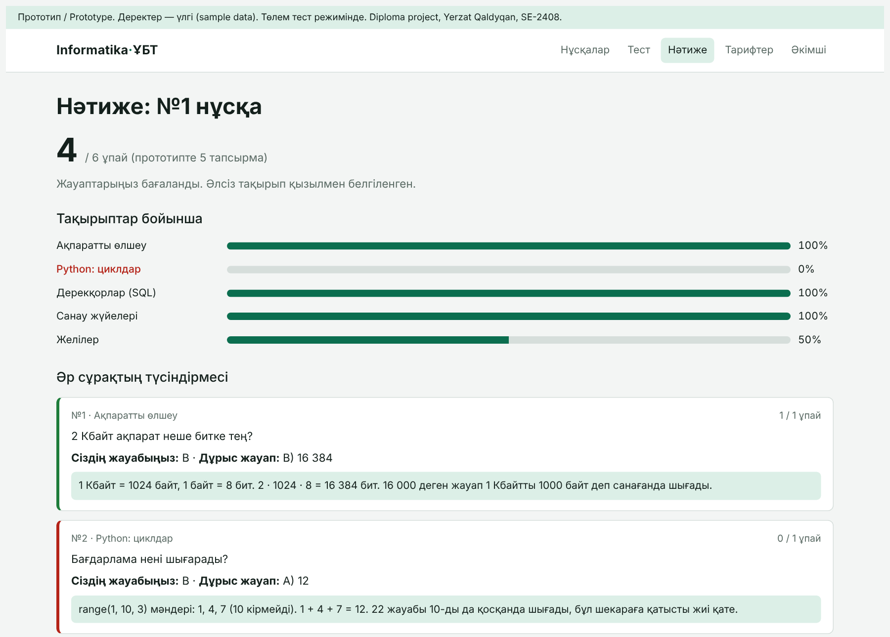
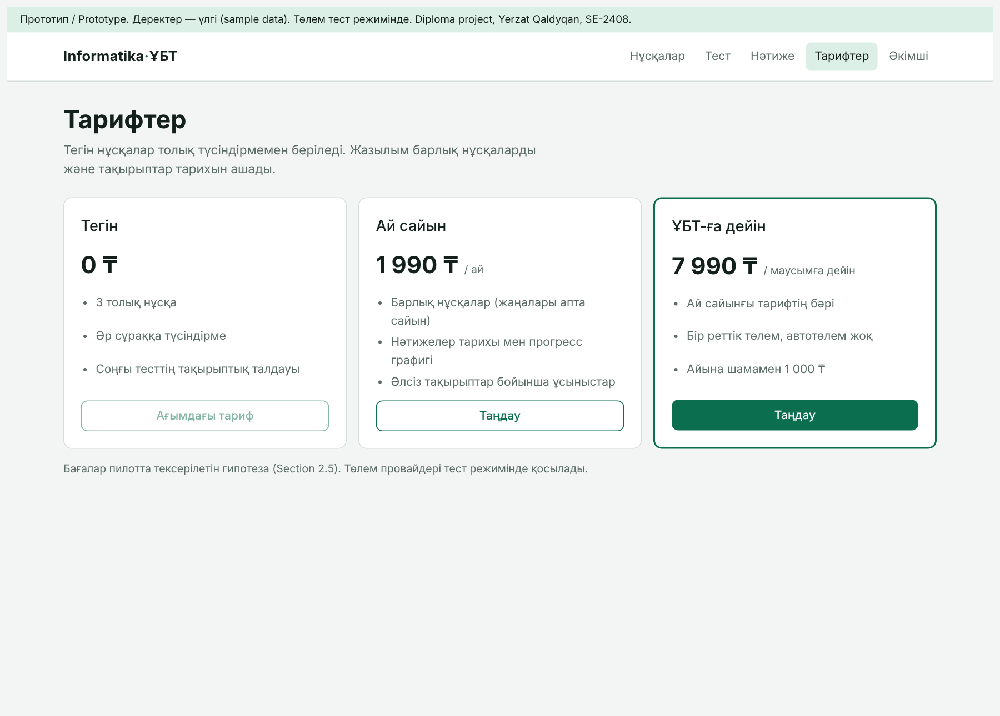
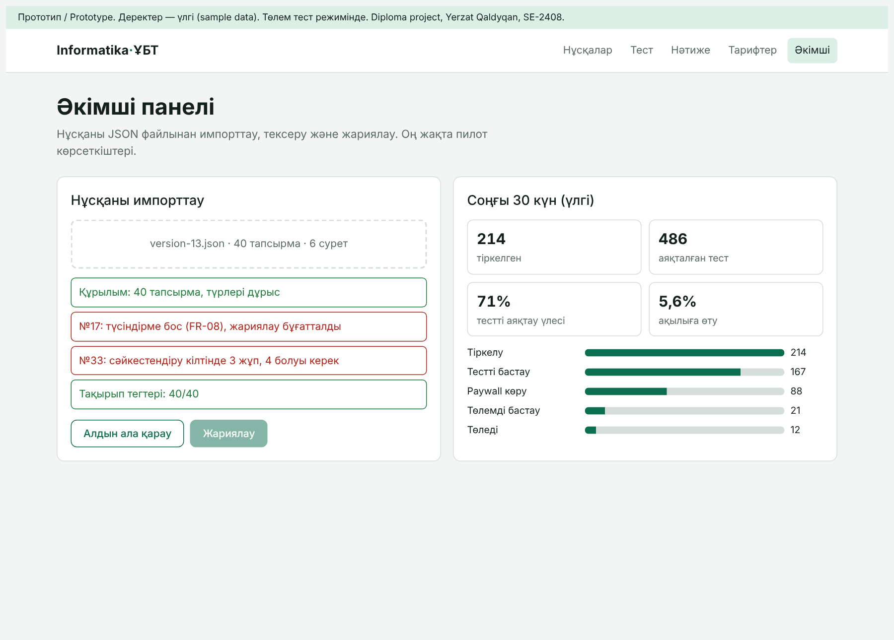

# 8. UX / Prototype

## 8.1 Prototype links

- **Clickable prototype (HTML):** `prototype/index.html` in the repository. Open it in any browser; it needs no installation.
- **Online version:** https://yerrrzat.github.io/Web-platform-UNT-/prototype/ (GitHub Pages, public)
- **Screenshots:** `prototype/screenshots/`

The prototype is in Kazakh (the primary interface language, NFR-07) and uses sample data. It is interactive: the timer runs, answers are selected and flagged, the test can be submitted, and the score, explanations and topic breakdown are calculated with the real scoring rules (FR-06).

## 8.2 Key user scenarios

| # | Scenario | Screens | Requirements |
|---|---|---|---|
| S1 | A student chooses a free version and starts a test | Catalogue → Test | FR-03, FR-05, FR-11 |
| S2 | A student answers items with code and SQL tables, flags an item, navigates through the answer sheet and submits | Test | FR-05, FR-07 |
| S3 | A student reviews the score, the weakest topic and the explanation for each item | Results | FR-06, FR-08, FR-09 |
| S4 | A student opens a premium version and is offered a subscription | Catalogue → Pricing | FR-11, FR-12 |
| S5 | The administrator imports a version, sees validation errors and cannot publish until they are fixed | Admin | FR-14, FR-15, FR-08 |
| S6 | The administrator checks the registration-to-payment funnel | Admin | FR-16, FR-17 |

## 8.3 Screens

### Catalogue (S1, S4)


Versions show the number, theme, difficulty, a free/premium label and the student's last result. Premium versions lead to the pricing page instead of the test.

### Test runner (S2)


The layout follows the UNT computer-based interface: one item at a time, an answer sheet of 40 cells on the side, a countdown timer that turns red under 5 minutes, flagging, and previous/next navigation. Code is shown in a monospaced block with highlighting; SQL items show the table above the query.

### Results (S3)


The results page shows the total score, a bar per specification topic (the weakest is highlighted in red) and every item with the student's answer, the correct answer and an explanation that names the typical error.

### Pricing (S4)


Three plans: Free (3 versions with full explanations), Monthly (1,990 KZT) and Until UNT (7,990 KZT, one payment). The second premium tier is a deliberate design choice based on Gu et al. (2018) [13]. Prices are hypotheses to be tested in the pilot.

### Admin (S5, S6)


Import validation lists errors per item number. Publishing is blocked while an explanation is missing. The dashboard shows the registration → test → paywall → checkout → payment funnel used for the commercialization assessment.

## 8.4 Example input data: version import format (JSON)

```json
{
  "number": 13,
  "title": "Аралас, ҰБТ-2026 форматы",
  "timeLimitMin": 80,
  "access": "premium",
  "items": [
    {
      "position": 2,
      "type": "single",
      "topics": ["python-loops"],
      "body": [
        {"kind": "text", "value": "Бағдарлама нені шығарады?"},
        {"kind": "code", "lang": "python", "value": "s = 0\nfor i in range(1, 10, 3):\n    s += i\nprint(s)"}
      ],
      "options": ["12", "22", "15", "10"],
      "answerKey": [0],
      "maxPoints": 1,
      "explanation": "range(1, 10, 3) мәндері: 1, 4, 7. 1 + 4 + 7 = 12."
    }
  ]
}
```

## 8.5 Planned usability checks

- Hallway test of the prototype with 3 students before development starts (Sprint 2). Task success and time are recorded for scenarios S1–S3.
- SUS questionnaire in the pilot (NFR-06, Section 9).
